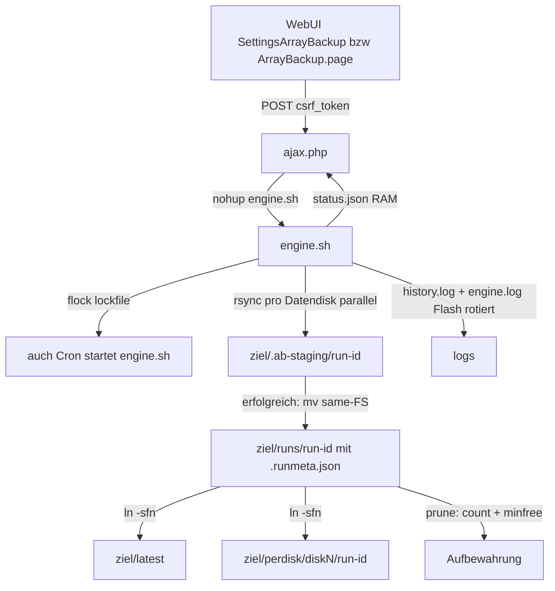

# Einarbeitung: unRAID ArrayBackup Plugin

Stand: Analyse des Repos `back` (Workspace `c:/Users/Administrator/Desktop/back`)

## Worum geht es

Eine einzige Plugin-Codebasis: **`unraid-array-backup/`** – ein unRAID-Plugin
(`arraybackup`), das **alle Datendisks des unRAID-Arrays parallel** per `rsync`
auf ein **lokal eingehängtes, schnelles Ziel** (z. B. RAID0 aus NVMe) sichert.
Jeder erfolgreiche Lauf ist ein **vollständiger Array-Snapshot**
(`rsync --link-dest`, Hartlinks = platzsparend, Time-Machine-Prinzip).
Parity-Disks fehlen unter `/mnt` und werden automatisch übersprungen.

Aktuelle Version laut `build.sh`: **`2026.11.05.002`**.

## Projektstruktur

```
back/
├── README.md                     # Wurzel: Verweis auf das eine Plugin
├── .gitattributes                # erzwingt LF für alle base64-eingebetteten Dateien
├── .gitignore                    # arraybackup.plg ist bewusst NICHT ignoriert (dient raw-URL)
├── .github/agents/coder.agent.md (ignore-Eintrag vorhanden)
└── unraid-array-backup/
    ├── README.md                 # Hauptdoku: Features, Layout, Testplan, Files
    ├── arraybackup.plg           # fertiges Manifest (generiert, eingecheckt, wird via raw-URL ausgeliefert)
    ├── build.sh                  # erzeugt PLG aus src/ + Validator als Build-Gate
    ├── tools/validate_plg.py     # PLG-Validator: XML, Base64, SHA256, CRLF/BOM
    └── src/
        ├── ArrayBackup.page      # WebUI: .page-Header (Menu="Settings:7"), Tabs, i18n (de/en)
        ├── SettingsArrayBackup.php  # Alt-Version der Settings-Seite (hartkodiert deutsch, ohne i18n) – nicht mehr im Build!
        ├── install.sh            # Post-Install/Boot: Verzeichnisse, Default-Config, Cron auf Flash
        └── include/
            ├── ajax.php          # JSON-API: config-get/-save, start, stop, status, runs, ls, pin, delete-run
            └── engine.sh         # Backup-Engine (der Kern)
```

## Bausteine & Verantwortung

### `src/include/engine.sh` – Engine (Bash)
- Konfiguration: `/boot/config/plugins/arraybackup/config.json` via `php -r`
  gelesen; **Defaults müssen mit `install.sh` und `ajax.php` identisch bleiben**
  (Kommentar Zeile 56–60 dokumentiert einen historischen Bug).
- `validate()`: Array läuft (Disks unter `/mnt/diskN`), Ziel existiert/ist
  beschreibbar, `findmnt --target=PATH` (bewusst `=`-Form, nicht `-T --`),
  Selbst-Backup-Schutz (`/mnt/disk*|/mnt/user*|/mnt/share*` abgelehnt),
  Hartlink-Test, Freiraum-Check (`retention_min_free_gb`).
- **Staging + atomare Promotion**: Läufe entstehen in
  `<ziel>/.ab-staging/r-<TS>/`; erst nach Erfolg atomares `mv` nach `runs/`
  (gleiches Dateisystem), dann `latest`-Symlink + `perdisk/`-Ketten, dann
  `prune()`. Abbrüche bleiben unsichtbar im `runs/`-Verzeichnis.
- **Resume (Etappen)**: `find_resumable_run()` findet staged oder legacy
  unfertige Läufe; `--partial-dir=.rsync-partial` + `-f 'R .rsync-partial/'`
  halten angebrochene Dateien aus dem Snapshot und ermöglichen Fortsetzung.
- **Retries**: rsync Exit 10/11/12/30 → max. 3 Versuche mit Backoff; Exit 24
  (verschwundene Quelldateien) gilt als Erfolg; Stop-Flag bricht ab.
- **Status**: `/var/run/arraybackup/status.json` (RAM), pro-Disk-Fortschritt
  aus rsync-`--info=progress2`-Logs **token-basiert** geparst (nicht
  feldpositions-basiert, wegen Versionsunterschieden).
- **JSON-Integrität**: `write_json()` validiert vor dem Schreiben per
  `json_decode`, schreibt atomar (tmp+rename), kompakt (kein Pretty-Print,
  denn `engine.sh` grep't `"state":"..."`).
- **Meta-Heilung**: `heal_run_meta()` rekonstruiert fehlende `.runmeta.json`
  aus `history.log`; `mark_stale_runs()` markiert `running` → `aborted`.
- **Promotion ohne Meta wird verweigert** (`die`) – WebUI liest nur Meta.
- Retention: `prune()` hält N unpinned Läufe + Freiraum-Guard; pinnt via
  `.pinned`-Marker. Log-Rotation: Flash-Logs > 1 MB → neueste 512 KB.
- Lockfile (`flock`), PID-File, Stop-Flag unter `/var/run/arraybackup/`.

### `src/include/ajax.php` – JSON-API (PHP)
- Actions: `config-get/-save`, `start`, `stop`, `status`, `runs`, `ls`
  (paginiert 500/limit≤2000), `pin`, `delete-run`.
- CSRF: **bewusst keine eigene Prüfung** – emhttp prüft `csrf_token` vor
  Auslieferung; eigene Prüfung gegen `var.ini` wäre fehleranfällig
  (ausführlicher Kommentar Zeile 81–87).
- `engine_running()` prüft PID **und** cmdline enthält `engine.sh`
  (PID-Reuse-Schutz).
- Pfad-Traversal-Schutz `safe_target_path()` für `ls`.
- Strenge Run-ID `r-\d{8}-\d{6}` für pin/delete (reservierte Namen wie
  `latest`/`runs`/`perdisk` kommen nie in `rm -rf`-Pfade).
- `delete-run` repariert `latest`-Symlink auf den letzten `success`-Lauf.
- `config-save` validiert Ziel **bei Save** (spiegelt `engine.validate()`).
- Zeitplan: eigene `.cron`-Datei auf Flash + `update_cron` (dynamix).

### `src/ArrayBackup.page` – WebUI (aktiv, im Build)
- Header `Menu="Settings:7"`, registriert sich automatisch im Settings-Menü.
- Tabs: Backups (Live-Fortschritt + Snapshot-Tabelle), Array-Browser
  (paginiert, „Mehr laden“), Disk-Historie, Konfiguration.
- **Zentrale String-Tabelle `STRINGS` (de/en)** + `data-i18n` + `T(key)`;
  HTML-escapen via `esc()` in Tabellen.
- Polling alle 2 s (`status`), Tabellen-Refresh nach Lauf-Ende.

### `src/SettingsArrayBackup.php` – Alt-Version (NICHT im Build)
- Wurde von `ArrayBackup.page` ersetzt (Build-Dateiliste in `build.sh`
  enthält nur `ArrayBackup.page`, `ajax.php`, `engine.sh`, `install.sh`).
- Enthält die alte, hartkodiert deutsche Variante ohne i18n/`esc()`.
- → Kandidat zum Löschen oder als Referenz markieren.

### `src/install.sh` – Post-Install/Boot
- Läuft bei Install/Update/Boot (`<FILE Run="/bin/bash">` im PLG).
- Legt tmpfs-Verzeichnisse neu an, schreibt Default-`config.json`
  (Defaults identisch zu `load_config`-Gegenstücken), erzeugt/löscht
  `arraybackup.cron` auf Flash, ruft `update_cron` auf.

### `build.sh` + `tools/validate_plg.py` – Build-Kette
- `build.sh` base64-embeddet alle `src/`-Payloads (CR-frei) mit `<SHA256>`-
  Blöcken; `pluginURL` = raw.githubusercontent.com/`godghost123/back`/main/…
  → **Repo muss öffentlich sein** für Auto-Update.
- Build-Gate: `validate_plg.py` prüft XML (ein `<PLUGIN>`-Root), Base64,
  SHA256, CRLF/BOM; Build bricht bei Fehlern ab.
- Deinstallations-Block (`Method="remove"`) räumt Plugin-Ordner.
- `.gitattributes`: LF für `*.sh/php/page/md/py/cron`; `arraybackup.plg
  -text` (unverändert ausliefern). `build.sh` strippt zusätzlich CR und warnt.

## Datenfluss (Ablauf)



## Wichtige Design-Entscheidungen (aus Kommentaren extrahiert)

1. **Staging vor Promotion** verhindert sichtbare Halb-Snapshots und
   schützt `--delete`-Läufe vor sichtbaren früheren Generationen.
2. **`findmnt --target=`** statt `-T -- PATH` (getopt frisst sonst das `--`).
3. **Kompaktes JSON** (`json_encode` ohne Pretty) – sonst brechen die
   `grep '"state":"'`-Auswertungen.
4. **Progress-Parsing per Token-Form**, nicht Feldposition (rsync-Format
   änderte sich zwischen Versionen).
5. **Keine doppelte CSRF-Prüfung** in ajax.php (emhttp prüft bereits).
6. **`arraybackup.plg` eingecheckt**, weil `pluginURL` genau diese Datei
   über raw.githubusercontent.com ausliefert.
7. **SHA256 in FILE-Blöcken** erzwingt Dateiaustausch bei Update (sonst
   überspringt der Manager existierende Dateien).

## Auffälligkeiten / offene Punkte (für spätere Arbeit)

- **`src/SettingsArrayBackup.php` ist verwaist**: nicht im Build, ältere
  Variante ohne i18n/`esc()`. Löschen oder explizit als Legacy kennzeichnen.
- README-Tabellen-Zeile „`src/ArrayBackup.page`“ vs. tatsächlich existierende
  `SettingsArrayBackup.php`: README erwähnt die Alt-Datei nicht.
- README „Known limits“: v1 spiegelt Disks nicht Shares, keine
  Checksummen/Benachrichtigungen, Retention nach Anzahl statt GFS.
- Engine und WebUI setzen voraus, dass `php`, `rsync`, `flock`, `findmnt`
  vorhanden sind (unRAID bringt sie mit).
- Version wird manuell in `build.sh` gepflegt (`VERSION`-Override möglich).

## Dateien-Referenz

| Datei | Zweck |
|---|---|
| `unraid-array-backup/README.md` | Hauptdoku (EN): Features, Target-Layout, Testplan |
| `unraid-array-backup/build.sh` | PLG-Generator + Validierungs-Gate |
| `unraid-array-backup/arraybackup.plg` | generiertes Manifest, ausgeliefert via raw-URL |
| `unraid-array-backup/tools/validate_plg.py` | PLG-Validator (XML/Base64/SHA256/CRLF) |
| `unraid-array-backup/src/include/engine.sh` | Engine: Staging, Promotion, Retention, Retries, Status |
| `unraid-array-backup/src/include/ajax.php` | JSON-API inkl. CSRF-Hinweis, Traversal-Schutz |
| `unraid-array-backup/src/ArrayBackup.page` | aktive WebUI (i18n de/en, Tabs, Polling) |
| `unraid-array-backup/src/SettingsArrayBackup.php` | verwaiste Alt-WebUI (nicht im Build) |
| `unraid-array-backup/src/install.sh` | Install/Boot: Config-Defaults + Cron |
