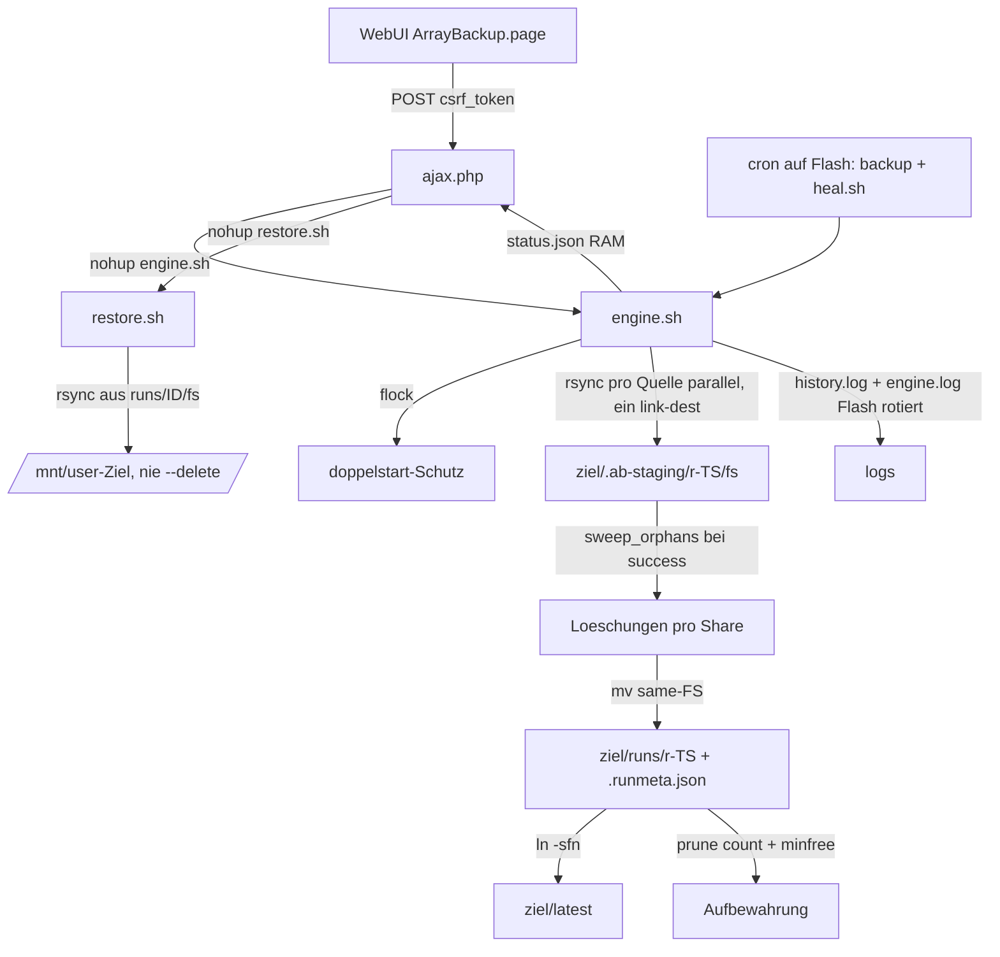

# Einarbeitung: unRAID ArrayBackup Plugin

Stand: 2026-11-06, Repo `back` (Workspace `c:/Users/Administrator/Desktop/back`),
Release **`2026.11.06.005`** (`build.sh` und eingechecktes `arraybackup.plg`
stimmen überein; die raw-URL liefert genau diese Version mit HTTP 200).

## Worum geht es

Eine einzige Plugin-Codebasis: **`unraid-array-backup/`** – ein unRAID-Plugin
(`arraybackup`), das **alle Datendisks des Arrays und die Pool-Mounts**
(`/mnt/cache`, …) **parallel** per `rsync` auf ein **lokal eingehängtes,
schnelles Ziel** (z. B. RAID0 aus NVMe) sichert. Alle Quellen schreiben in
**einen gemeinsamen Snapshot-Baum** `runs/<TS>/fs/` – Time-Machine-Prinzip per
`rsync --link-dest=<latest>/fs` (Hartlinks, mover-umgezogene Dateien werden im
nächsten Lauf hart verlinkt statt erneut kopiert, delta ≈ 0).
Parity-Disks fehlen unter `/mnt` und werden automatisch übersprungen.
Aus dem Browser kann **restore** any file/folder back to a share or test folder
(restore.sh).

## Projektstruktur

```
back/
├── README.md                     # Wurzel: Verweis auf das eine Plugin
├── .gitattributes                # LF fuer alle eingebetteten Texte; *.png -text
├── .gitignore                    # arraybackup.plg bewusst NICHT ignoriert (raw-URL)
├── plans/                        # Plaene und Bewertungen (Einarbeitung, Entwuerfe)
└── unraid-array-backup/
    ├── README.md                 # Hauptdoku (EN): Features, fs-Layout, Restore, Testplan
    ├── arraybackup.plg           # fertiges Manifest (generiert, eingecheckt, raw-URL)
    ├── build.sh                  # erzeugt PLG aus src/ + Validator als Build-Gate
    ├── tools/validate_plg.py     # PLG-Validator: XML, Base64, SHA256, CRLF/BOM
    └── src/
        ├── ArrayBackup.page      # WebUI: Menu="Utilities" (User-Utilities-Kachel), Tabs, i18n de/en
        ├── install.sh            # Post-Install/Boot: Config-Defaults, Cron + heal.sh auf Flash
        └── include/
            ├── ajax.php          # JSON-API: config, start/stop/status, runs, ls, pin,
            │                     # delete-run, restore-start/-status/-stop, shares-list
            ├── engine.sh         # Backup-Engine (der Kern)
            ├── restore.sh        # asynchroner Restore-Job (rsync, progress/stop)
            └── hard-disk.png     # Icon fuer die User-Utilities-Kachel (base64, Rohbytes)
```

Historie: `src/SettingsArrayBackup.php` (alte hartkodiert deutsche Settings-Seite)
und der Tab „Disk-Historie“ samt `perdisk/`+`pershare/`-Symlink-Sichten sind mit
Release 2026.11.06.005 entfernt; die Engine raeumt alte Link-Wurzeln einmal pro
Lauf.

## Bausteine & Verantwortung

### `src/include/engine.sh` – Engine (Bash)
- Konfiguration: `/boot/config/plugins/arraybackup/config.json` via `php -r`
  gelesen; **Defaults muessen mit `install.sh` und `ajax.php` identisch bleiben**
  (Zeilen 94–95: `backup_pools`, `pool_filter`, `skip_shares`, …).
- `php -r` liest Pfade/Bodies **ueber stdin/Env, nie `$argv`**
  (`register_argc_argv=Off` in der php.ini lahme frueher jede JSON-Ausgabe);
  `write_json()` hat einen **pure-bash-Fallback** (validiert tmp+rename).
- `validate()`: Array laeuft, Ziel existiert/beschreibbar,
  `findmnt --target=PATH` (bewusst `=`-Form, nicht `-T --`),
  Selbst-Backup-Schutz (auch Quellen, die das Ziel **enthalten**), Hartlink-Test,
  Freiraum-Check (`retention_min_free_gb`).
- `discover_sources()`: `/mnt/disk[0-9]*` + Pool-Mounts (`findmnt`-Prüfung,
  Ziel/Mounts wie `user`/`recycle`/`unraid`/`remotes`/`.array` ausgeschlossen),
  optional `pool_filter`.
- **Staging + atomare Promotion**: Läufe entstehen in
  `<ziel>/.ab-staging/r-<TS>/fs/`; erst nach Erfolg atomares `mv` nach `runs/`,
  dann `latest`-Symlink, dann `prune()`. Abbrüche bleiben unsichtbar.
- **Kein `--delete` pro Job** – Löschungen spiegelt `sweep_orphans()` pro Share
  nach allen Transfers (find+comm+rm). Guards: nur bei `success`, nur in
  staging, jede Quelle noch gemountet, Loeschmenge <= 50 % (sonst Abbruch,
  `state=partial`).
- **Share-Filter** einheitlich auf allen Jobs: Realitaets-Check
  (`/mnt/diskN/<share>` vorhanden?), `shareUseCache=only|system` aus
  `/boot/config/shares/<share>.cfg`, manuell `skip_shares`.
- **Resume (Etappen)**: `find_resumable_run()`; `--partial-dir=.rsync-partial`
  + `-f 'R .rsync-partial/'`.
- **Retries**: rsync Exit 10/11/12/30 → max. 3 Versuche mit Backoff; Exit 24 =
  Erfolg; Stop-Flag bricht ab.
- **Status**: `/var/run/arraybackup/status.json` (RAM), Phasen
  (setup/transfer/finalize), Fortschritt token-basiert aus
  `--info=progress2`-Logs geparst.
- **Meta**: `.runmeta.json` zwingend vor Promotion (`die` sonst);
  `heal_run_meta()` rekonstruiert aus `history.log`; `mark_stale_runs()`
  markiert `running` → `aborted`; `orphan_dirs`/`swept_deleted` in der Meta.
- Retention: `prune()` (Anzahl + Freiraum-Guard, `.pinned`-Marker).
  Log-Rotation: Flash-Logs > 1 MB → neueste 512 KB.
- Lockfile (`flock`), PID-File, Stop-Flag unter `/var/run/arraybackup/`.

### `src/include/restore.sh` – Restore-Job (Bash, neu seit 06.005)
- Gestartet per `nohup` von `ajax.php`; Parameter **nur ueber Env**
  (`AB_SRC`, `AB_DEST`, `AB_MODE`, `AB_RID`).
- `rsync -aHAX --numeric-ids --stats --info=progress2`, **nie `--delete`**;
  Modus skip = `--ignore-existing`. Exit 0/24 = success.
- Eigene Dateien: `/var/run/arraybackup/restore.{json,pid}` +
  `restore.stop.flag`; Log auf Flash.

### `src/include/ajax.php` – JSON-API (PHP)
- Actions: `config-get/-save`, `start`, `stop`, `status`, `runs`, `ls`
  (paginiert), `pin`, `delete-run`, `restore-start/-status/-stop`,
  `shares-list` (Top-Level aus `runs/<id>/fs`).
- CSRF: **keine eigene Pruefung** – emhttp prueft `csrf_token` vor Auslieferung.
- `engine_running()`/`restore_running()` pruefen PID **und** cmdline
  (PID-Reuse-Schutz); Backup und Restore schliessen sich gegenseitig aus.
- Traversal-Schutz `safe_target_path()`; Run-ID strikt `r-\d{8}-\d{6}`;
  Restore-Ziel nie im Backup-Ziel/unter `/mnt/`-Systempfaden.
- `delete-run` repariert `latest` und raeumt Legacy-`perdisk`/`pershare`-Links.
- Zeitplan: `.cron`-Datei auf Flash + `update_cron` (dynamix);
  **kein** User-Feld in den Cron-Zeilen (Unraid liest sie als Crontab ohne
  Benutzer – „root“ an der Kommandostelle war ein toedlicher Bug).

### `src/install.sh` – Post-Install/Boot + Self-Heal
- Laeuft bei Install/Update/Boot (`<FILE Run="/bin/bash">`).
- Legt tmpfs-Verzeichnisse an, schreibt Default-`config.json`, erzeugt/löscht
  `arraybackup.cron` (Backup-Zeitplan + **heal.sh alle 30 min**), ruft
  `update_cron` auf.
- `heal.sh` (auf Flash): fehlt die PLG-Registration auf dem Flash, laedt sie
  `heal.sh` von der RAW-URL nach und installiert bei fehlendem tmpfs-Payload neu.

### `src/ArrayBackup.page` – WebUI
- Header `Menu="Utilities"` (auf dem Server verifizierte Schreibweise der
  User-Utilities-Kacheln), `Icon="hard-disk.png"`, `launch="Utilities/ArrayBackup"`.
- Tabs: Backups (Live-Fortschritt + Snapshot-Tabelle), Array-Browser
  (paginiert, Restore-Button pro Eintrag), Konfiguration.
- Zentrale String-Tabelle `STRINGS` (de/en), `esc()` in Tabellen, Polling 2 s.

### `build.sh` + `tools/validate_plg.py` – Build-Kette
- `build.sh` base64-embeddet alle Payloads (Texte CR-frei, PNG **Rohbytes** mit
  `.gitattributes *.png -text`), mit `<SHA256>`-Blocken; `pluginURL` =
  raw.githubusercontent.com/`godghost123/back`/main/… → Repo ist **oeffentlich**
  (verifiziert: HTTP 200).
- Build-Gate: `validate_plg.py` (XML/Base64/SHA256/CRLF/BOM); Build bricht ab.
- Version manuell in `build.sh` (`VERSION`-Override moeglich).

## Datenfluss (Ablauf)



## Wichtige Design-Entscheidungen (aus Kommentaren)

1. **Staging vor Promotion** – kein sichtbarer Halb-Snapshot; Sweep nur in staging.
2. **Ein gemeinsamer `fs/`-Baum + ein `--link-dest`** – mover-Umzug = Hartlink.
3. **Orphan-Sweep statt rsync `--delete`** – Mengen­differenz pro Share, Huerde 50 %.
4. **`findmnt --target=`** statt `-T --` (getopt frisst sonst das `--`).
5. **stdin/Env statt `$argv` + bash-Fallback** fuer JSON – `register_argc_argv`-Falle.
6. **Kein User-Feld in `.cron`** – Unraid-Plugin-Crons sind reine Crontabs.
7. **Keine doppelte CSRF-Prüfung** (emhttp prueft bereits).
8. **`arraybackup.plg` eingecheckt** + SHA256 je FILE – Manager ersetzt Dateien.
9. **PNG als Rohbytes base64** (`*.png -text`), mkdir-Run-Block vor dem Icon-FILE.
10. **CRLF-Guards**: `.gitattributes` LF + `build.sh` warnt und strippt CR.

## Auffaelligkeiten / offene Punkte (Stand 2026-11-06)

- **Server-Verifikation unvollstaendig**: Die Unraid-API liefert keine
  Plugin-Details; SSH war ohne Key nicht moeglich. Das Update-Ticket vom 05.11.
  („arraybackup – Version update 2026.11.05.007“) ist immer noch UNREAD –
  Hinweis, dass auf dem Server moeglicherweise noch 2026.11.05.007 laeuft und
  2026.11.06.005 erst installiert werden muss.
- Kein CI: `validate_plg.py` + `tools/test_write_json.sh` +
  `tools/test_discover_shares.sh` laufen nur lokal.
- Sweep-Huerde 50 % hartkodiert; Loeschliste pro Lauf fehlt (nur Zaehler).
- Keine unRAID-Benachrichtigungen bei Lauf-Ende/Fehler (nur Log/WebUI).
- Version manuell in `build.sh` gepflegt.
- Desktop-Ebene enthaelt Arbeitsartefakte (`tmp_*`) -> Repo-Hygiene.

## Dateien-Referenz

| Datei | Zweck |
|---|---|
| `unraid-array-backup/README.md` | Hauptdoku (EN): Features, fs-Layout, Restore, Testplan |
| `unraid-array-backup/build.sh` | PLG-Generator + Validierungs-Gate, Version hier |
| `unraid-array-backup/arraybackup.plg` | generiertes Manifest, ausgeliefert via raw-URL |
| `unraid-array-backup/tools/validate_plg.py` | PLG-Validator (XML/Base64/SHA256/CRLF) |
| `unraid-array-backup/src/include/engine.sh` | Engine: Quellen, Staging, Sweep, Promotion, Retention |
| `unraid-array-backup/src/include/restore.sh` | asynchroner Restore-Job |
| `unraid-array-backup/src/include/ajax.php` | JSON-API inkl. Restore- und shares-list-Actions |
| `unraid-array-backup/src/ArrayBackup.page` | aktive WebUI (i18n de/en, Tabs, Restore-Dialog) |
| `unraid-array-backup/src/include/hard-disk.png` | Icon der User-Utilities-Kachel |
| `unraid-array-backup/src/install.sh` | Install/Boot: Defaults + Cron + heal.sh |
