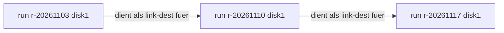
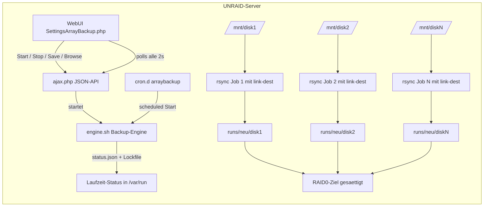
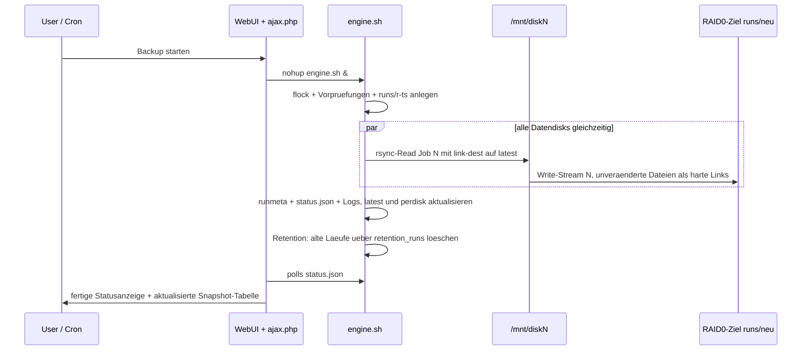

# UNRAID Array Backup Plugin – Architekturplan (v2: mit Versionierung/Retention)

## Ziel

Ein UNRAID-Plugin (`arraybackup`), das alle Datendisks des Arrays (`/mnt/disk1..N`, Parität wird übersprungen) **gleichzeitig parallel einliest** und **gebündelt auf ein lokales, schnelles RAID0-Ziel** schreibt (Datei-Ebene, `rsync`). Jeder Lauf erzeugt einen **vollständigen Snapshot des gesamten Arrays** (hart verkettet via `--link-dest`, space-effizient wie Time Machine). Die WebUI bietet **zwei Ansichten**:

1. **Array-Snapshots** – jeder Lauf sieht aus, als wäre das komplette Array auf einmal gesichert worden (alle Disks nebeneinander in einem Lauf-Ordner)
2. **Disk-Historie** – pro Disk eine chronologische Kette ihrer Snapshots

## Rahmenbedingungen (vom User bestätigt)

| Aspekt | Entscheidung |
|---|---|
| Ausführungsort | Direkt auf dem UNRAID-Server |
| Schreib-Ziel | Lokal angeschlossenes RAID0-Laufwerk (gemountet, z. B. `/mnt/backup`) |
| Granularität | Datei-Ebene, paralleles rsync pro Disk, Paritäts-Platten werden übersprungen |
| Form | Vollständiges `.plg`-Plugin mit WebUI (Settings-Menü), Scheduler, Statusanzeige |
| Versionierung | **In v1**: Snapshot pro Lauf via `rsync --link-dest` (harte Links), Retention nach Anzahl + Pinning |
| Ansichten | Zielstruktur + WebUI-Tabs für „Komplettes Array" und „Pro Disk" |

## Zielstruktur auf dem RAID0-Backup-Laufwerk

```
/mnt/backup/
├── runs/
│   ├── r-20261103-020000/
│   │   ├── .runmeta.json        # Status pro Disk, Exit-Codes, Bytes, Zeiten
│   │   ├── disk1/               # 1:1-Inhalt von /mnt/disk1 zum Laufzeitpunkt
│   │   ├── disk2/
│   │   └── diskN/
│   └── r-20261110-020000/
│       └── ...                  # identische Struktur = „Array als Ganzes"
├── latest -> runs/r-20261110-020000          # Symlink auf letzten erfolgreichen Lauf
└── perdisk/                                   # Disk-Historie als Symlink-Farm
    ├── disk1/
    │   ├── r-20261103-020000 -> ../../runs/r-20261103-020000/disk1
    │   └── r-20261110-020000 -> ../../runs/r-20261110-020000/disk1
    └── diskN/
        └── ...
```

- **Array-Ansicht:** `runs/<timestamp>/` enthält alle Disks nebeneinander → wirkt wie eine Komplett-Sicherung des Arrays zu diesem Zeitpunkt.
- **Disk-Ansicht:** `perdisk/diskN/` ist eine reine Symlink-Farm (ein Symlink pro Lauf, kein Daten-Overhead) → chronologische Historie pro Disk.
- **Space-Effizienz:** Unveränderte Dateien in neueren Läufen sind **harte Links** auf die Blöcke des vorherigen Laufs. Ein alter Lauf-Ordner zu löschen beschädigt niemals neuere Läufe (Inodes bleiben so lange erhalten, bis alle Links weg sind).

### Snapshot-Kette (link-dest-Prinzip)



`--link-dest` zeigt immer auf den **letzten vollständig erfolgreichen Lauf** dieser Disk. Schlägt eine Disk in einem Lauf fehl, wird der Lauf als `partial` markiert; `latest` und künftige link-dest-Werte referenzieren nur `success`-Läufe.

## Komponenten



### 1. Plugin-Gerüst (`arraybackup.plg`)

- XML-Header mit Plugin-Name, Version, `pluginURL`
- `<file>`-Payloads (base64-heredoc), bei jedem Boot re-installiert:
  - `/usr/local/emhttp/plugins/arraybackup/SettingsArrayBackup.php` → Menü-Eintrag im **Settings-Menü** (Namenskonvention `Settings*.php`)
  - `/usr/local/emhttp/plugins/arraybackup/include/engine.sh` → Backup-Engine
  - `/usr/local/emhttp/plugins/arraybackup/include/ajax.php` → JSON-API
  - `/usr/local/emhttp/plugins/arraybackup/images/icon.png`
- Persistente Daten (Flash): `/boot/config/plugins/arraybackup/config.json`, `excludes.txt`, `logs/` (nur Lauf-Summen, flash-schonend)
- Laufzeit-Status (RAM): `/var/run/arraybackup/status.json`, `disk<N>.progress`, Lockfile via `flock`

### 2. Backup-Engine (`engine.sh`)

**Vorprüfungen:**
- Array gestartet, `ls -d /mnt/disk[0-9]*` → Datendisks (Parität unter `/mnt` nicht gemountet → automatisch übersprungen)
- Ziel gemountet, Dateisystem unterstützt harte Links/Symlinks (ext4/xfs/btrfs; FAT/exFAT → Abbruch mit klarer Meldung)
- Ziel nicht auf einer Array-Disk selbst (Selbst-Backup-Schutz)
- Freiraum-Check: `df` gegen konfigurierbares Minimum (`retention_min_free_gb`)
- Lockfile-Check (kein Doppelstart); alter `running`-Lauf ohne lebendes Lock → als `aborted` markieren und neu starten

**Lauf-Ablauf:**
1. Neues Laufverzeichnis `runs/r-<JJJJMMTT-HHMMSS>/` anlegen, `.runmeta.json` mit `state=running` schreiben
2. **Pro Disk ein paralleler rsync-Hintergrundjob** (alle gleichzeitig, `&` + `wait`, optional `MAX_JOBS`-Drossel):
   `rsync -aHAX --numeric-ids --delete --link-dest=<latest-success>/diskN --stats --info=progress2 --exclude-from=<excludes> /mnt/diskN/ runs/r-<ts>/diskN/`
   → mehrere Schreibströme gesättigt auf das RAID0-Ziel; `--delete` ist je Snapshot implizit (Snapshot = vollständiger Mirror der Disk zu diesem Zeitpunkt)
3. Nach `wait`: Exit-Codes einsammeln → `.runmeta.json` aktualisieren (`success` / `partial` / `failed`), `logical_bytes` (du) und `delta_bytes` (rsync-stats) pro Disk und gesamt speichern
4. Bei `success`: `latest`-Symlink umsetzen, `perdisk/`-Symlinks für diesen Lauf ergänzen
5. **Retention:** älteste `success`-Läufe über `retention_runs` hinaus löschen (gepinnte Läufe ausnehmen), danach `latest` und `perdisk/`-Farm bereinigen
6. Lauf-Summen-Log nach `/boot/config/plugins/arraybackup/logs/`

**Fortschritts-Tracking:** jeder rsync schreibt `--info=progress2` in `/var/run/arraybackup/disk<N>.progress`; Engine aggregiert in `status.json` (pro Disk: %, Rate, ETA; global: Start, Lauf-ID, Fehler).

**Dry-Run-Modus:** `rsync -n`, kein Laufverzeichnis, keine Symlinks, nur Größen-Schätzung.

### 3. WebUI (`SettingsArrayBackup.php`)

**Tab „Backups" (Hauptansicht):**
- **Array-Snapshots:** Tabelle aller Läufe (Datum, Status-Chips pro Disk, logische Größe, Delta-Größe, Dauer, Pin-Button, Delete-Button) + Live-Fortschrittsbalken pro Disk während eines laufenden Backups
- Klick auf Lauf → eingebauter Datei-Browser zeigt `runs/<ts>/` mit allen Disk-Ordner nebeneinander (= Komplett-Sicht auf das Array)

**Tab „Disk-Historie":**
- Disk-Auswahl (disk1..N) → chronologische Timeline ihrer Snapshots (gespiegelt aus `perdisk/diskN/`) → Datei-Browser pro Snapshot

**Tab „Konfiguration":**
- Ziel-Mountpoint, `retention_runs`, `retention_min_free_gb`, `max_jobs`, `bwlimit`, Exclude-Pattern, Dry-Run, Zeitplan (Cron-Ausdruck + Ein/Aus)
- Buttons: **Backup starten**, **Stopp**, **Konfiguration speichern**

**Sicherheit Browser-Endpoint:** `action=ls` löst Pfade via `realpath` auf und erzwingt Bleiben innerhalb der Ziel-Wurzel (Traversal-Schutz).

### 4. Scheduler

- Plugin schreibt `/etc/cron.d/arraybackup` (bei jedem Boot re-installiert, Inhalt aus `config.json`)
- `ajax.php` (Speichern) aktualisiert die Cron-Datei und lädt `crond` neu (`kill -HUP`)

## Repo-Verzeichnisstruktur

```
unraid-array-backup/
├── arraybackup.plg              # Plugin-Manifest + eingebettete Payloads
├── src/
│   ├── SettingsArrayBackup.php  # WebUI mit Tabs Backups / Disk-Historie / Konfiguration
│   ├── include/ajax.php         # JSON-API
│   ├── include/engine.sh        # Backup-Engine inkl. Snapshot + Retention
│   └── images/icon.png
├── build.sh                     # erzeugt .plg aus src/ (base64-Payloads)
└── README.md                    # Installation + Bedienung
```

## Konfigdatei `config.json` (Schema)

```json
{
  "target": "/mnt/backup",
  "versioning": true,
  "retention_runs": 14,
  "retention_min_free_gb": 500,
  "exclude_file": "/boot/config/plugins/arraybackup/excludes.txt",
  "max_jobs": 0,
  "bwlimit_kbps": 0,
  "dry_run": false,
  "schedule_enabled": false,
  "schedule_cron": "0 2 * * 7"
}
```

## Sequence-Diagramm (typischer Lauf)



## Umsetzungs-TODOs

1. Repo-Gerüst + `build.sh` (src → `arraybackup.plg` mit base64-Payloads)
2. `engine.sh` Basis: Disk-Erkennung, Vorprüfungen (inkl. FS-Link-Support + Selbst-Backup-Schutz), flock, Stale-Run-Bereinigung
3. `engine.sh` Snapshots: Laufverzeichnis, parallele rsync-Jobs mit `--link-dest`, `.runmeta.json`, `latest`-Symlink, `perdisk/`-Symlink-Farm
4. `engine.sh` Retention: Pruning alter Läufe (Anzahl + Pinning), `latest`/`perdisk`-Bereinigung, Größen-Statistiken (du + rsync-stats)
5. `engine.sh` Betrieb: status.json-Fortschrittsaggregation, Logging, Dry-Run
6. `ajax.php`: `config-get/-save`, `start`, `stop`, `status`, `runs` (Laufliste), `ls` (Browser mit Traversal-Schutz), `pin`, `delete-run`
7. WebUI Tab „Backups": Konfig-Formular, Start/Stopp, Live-Fortschrittsbalken, Snapshot-Tabelle mit Pin/Delete
8. WebUI Tabs „Array-Browser" und „Disk-Historie": Snapshot-Auswahl + Datei-Browser, Disk-Timeline
9. Scheduler: `/etc/cron.d/arraybackup` aus `config.json` generieren + crond-Reload
10. README.md: Installations- und Testanleitung (Dry-Run, Snapshot-Kette verifizieren, Retention-Test, Abbruch, Doppelstart-Sperre)

## Optionale Ausbaustufen (nicht in v1)

- Share-Ansicht: Rekonstruktion der unRAID-User-Shares (Union-View aus `/boot/config/shares/*.cfg`) als dritte Ansicht
- Verifikationslauf (Prüfsummen) nach Backup
- Benachrichtigung (E-Mail/Discord) am Lauf-Ende
- GFS-Retention (täglich/monatlich/jährlich) statt reiner Anzahl
- Integration in das dynamix-Scheduler-Plugin statt eigener cron.d-Datei

## Teststrategie

- Dry-Run gegen kleines Testdataset auf unRAID-Testarray oder VM
- Snapshot-Kette prüfen: zwei Läufe, identische Dateien als harte Links (`stat`-Inode-Vergleich), Delta-Größe ≈ nur Änderungen
- Abbruch-/Resume-Test: abgebrochener Lauf → `partial`, nächster Lauf link-dest bleibt letzter `success`
- Retention-Test: `retention_runs=3`, 5 Läufe → genau 3 behalten, gepinnte Läufe überleben, `latest`/`perdisk` konsistent
- Doppelstart-Sperre (Lockfile) und Ziel-Unmount während Lauf → Status `failed`
