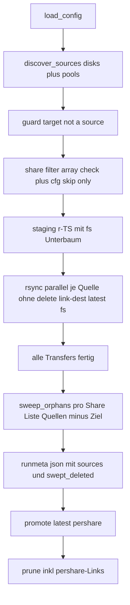

# Vorschlag: Merged-Backup – Disks + Pools parallel in **einen** Zielbaum

## 0. Anforderung (Stand nach Klärung)

- Quellen bleiben `/mnt/diskN` (eine Parallellauf pro Disk, wie heute).
- Zusätzlich werden die **Pool-Mounts** (`/mnt/cache`, weitere Pools) als
  Quellen gelesen.
- Im Backup-Ziel landet **alles in einem gemeinsamen Verzeichnisbaum**
  (`fs/<share>/…`), nicht getrennt nach Quelle.
- Damit sind Speicherort-Wechsel (mover cache → array) für das Backup
  **belanglos**: die Datei hat im Ziel denselben relativen Pfad und wird per
  `--link-dest` hart verlinkt statt erneut kopiert.

## 1. Warum das funktioniert

`rsync --link-dest=ALT` verlinkt eine Datei hart aus ALT, wenn **relativer
Pfad + Größe + mtime + Checksummen-Metadaten** übereinstimmen. Es spielt
keine Rolle, aus welchem Mount die Quelle kommt.

| Ereignis | Relative Pfad im Ziel | Kosten |
|---|---|---|
| mover verschiebt Datei cache → disk3 zwischen zwei Läufen | unverändert `<share>/…/<datei>` | **harter Link**, kein Transfer (delta ≈ 0) |
| Datei existiert auf Array **und** Pool (Pool gewechselt) | einmal | einmal abgelegt, kein Duplikat |
| Share von disk1 auf disk2 umgezogen | unverändert | harter Link |

Voraussetzung: alle Jobs teilen sich **ein** `--link-dest`, nämlich
`<latest>/fs`. Genau das ist der Unterschied zum heutigen Design, das pro
Disk `latest/diskN` verknüpft.

## 2. Ziel-Layout

```
/mnt/backup/
├── .ab-staging/.rsync-partial/        # wie bisher
├── runs/<id>/
│   ├── .runmeta.json                  # Sektion "sources" statt "disks"
│   └── fs/                            # EIN gemeinsamer Baum = /mnt/user-Spiegel
│       ├── appdata/…                  #   Inhalt kommt von diskN UND cache
│       ├── data/…
│       ├── isos/…
│       └── …
├── pershare/
│   └── <share>/<id> -> ../../runs/<id>/fs/<share>     # zwei Ebenen hoch
├── perdisk/                           # bleibt als Kompatibilitäts-/Debug-Sicht
│   └── diskN/<id> -> ../../runs/<id>/fs              # zeigt auf denselben Baum
└── latest -> runs/<id>
```

- Ein Share-Ordner im Ziel = Union aller Quellen → Restore geschieht durch
  Zurückkopieren nach `/mnt/user/<share>`, genau wie gewünscht.
- **Kompatibilität zum Bestand:** das heutige Layout ist
  `runs/<id>/diskN/<share>/…`. Der Umstieg auf `fs/<share>/…` findet **ein
  einziges Mal** statt: erster neuer Lauf hat kein passendes `--link-dest`
  → **einmaliger Vollkopier-Lauf** (Plattenbedarf ≈ einfache Datenmenge,
  `retention_min_free_gb` beachten; alte Läufe laufen per Retention aus).
  Wer das vermeiden will, kann `--link-dest` einmalig manuell auf einen
  alten `diskN`-Ordner setzen – bringt aber nur für einen Disk etwas.

## 3. Kernproblem: `--delete` in geteiltem Ziel

Heute löscht jeder Disk-Job mit `--delete-delay` verwaiste Dateien in seinem
eigenen Zielordner ([engine.sh:416](../unraid-array-backup/src/include/engine.sh:416)).
In einem geteilten Baum ist das **falsch**: der disk1-Job würde alles
löschen, was nicht von disk1 stammt.

Entschieden: **Orphan-Sweep pro Share nach allen Transfers.**

1. Alle Jobs laufen **ohne** `--delete` in den geteilten Baum.
2. Nach Abschluss aller Transfers pro Share ein **Bereinigungspass**
   (Orphan-Sweep):
   - Liste A = union aller Quellen dieses Shares:
     `find /mnt/disk*/<share> /mnt/<pool>/<share> -type f -printf '%P\n'`
     (sortiert, dedupliziert)
   - Liste B = Bestand im Ziel `runs/<id>/fs/<share>`
   - `B − A` löschen: `comm -13 A B` liefert die Orphans, gelöscht mit
     `xargs -d '\n' -r rm --` (Pfade relativ zum Ziel-Share-Ordner, Prefix
     anhängen), danach leere Verzeichnisse mit `find -depth -type d -empty
     -delete` entfernen. Ausgeschlossen werden `.rsync-partial/` und die
     Shares der `skip`-/`.cfg`-Liste (sie fehlen in A und B ohnehin).
   - **kein** `rsync --delete` von einer leeren Hilfsquelle: das würde den
     kompletten Share-Ordner im Ziel leeren, nicht nur die Orphans – die
     Mengen­differenz ist der einzig sichere Weg.
   - Aufwändig ist das nicht: reine Metadaten, die Quellen wurden gerade von
     rsync gescannt (Page-Cache warm).
   - **Sicherheitsbedingungen (nicht verhandelbar):**
     - Sweep läuft **nur**, wenn `state=success` (alle Exits 0/24, kein
       `stop.flag`) – bei Abbruch oder Fehlern wird gar nicht bereinigt,
       der Run bleibt ohnehin unstaged.
     - Sweep läuft **in der staging-Kopie**, nie im sichtbaren `latest`
       (das heutige Versprechen „`--delete` läuft nie gegen eine sichtbare
       Snapshot-Generation“ bleibt erhalten).
     - Dry-Run: nur Zähler/report, kein Löschvorgang.
     - Löschmenge > eine Hürde (z. B. 50 % des Zielbestands eines Shares)
       → abbrechen, `state=partial`, Meldung ins syslog. Schutz gegen
       ausgefallene/quelllose Shares (z. B. Pool nicht gemountet), die
       sonst den halben Snapshot wegputzen würden.
     - Vor dem Sweep wird geprüft, dass **jede erwartete Quelle gemountet
       war**; fehlende Quelle(n) → Sweep für betroffene Shares aussetzen.
3. Exit 24 (Quelle verschwindet während des Laufs, mover) bleibt tolerated
   ([engine.sh:467](../unraid-array-backup/src/include/engine.sh:467)); der
   Sweep läuft danach und räumt die Reste korrekt weg.

Der Sweep ist bewusst pro Share (nicht pro Quelle), damit Umzüge zwischen
Quellen nie als „gelöscht“ fehlinterpretiert werden.

## 4. Engine-Änderungen (`src/include/engine.sh`)

1. **`discover_sources()`** ersetzt die reine
   `DISKS`-Sammlung ([engine.sh:186](../unraid-array-backup/src/include/engine.sh:186)):
   - `/mnt/disk[0-9]*` wie bisher
   - plus Pools: Kandidaten `/mnt/*`, verwerfen
     `user`, `recycle`, `unraid`, `remotes`, `.array`, `disk[0-9]*` und das
     eigene Backup-Ziel; Rest nur bei echtem Dateisystem
     (`findmnt --target=`, btrfs/xfs/ext4/zfs)
   - Reihenfolge: Disks zuerst, dann Pools → ein eventueller Konfliktfall
     (identer Pfad auf zwei Quellen) wird deterministisch entschieden.
2. **Job-Schleife** pro Quelle, aber **ein** Ziel:
   - Quelle `/mnt/disk1/` → `stage_root/fs/`, Quelle `/mnt/cache/` →
     `stage_root/fs/` (relative Pfade identisch)
   - Args: `-aHAX --numeric-ids --stats --info=progress2
     --partial-dir=.rsync-partial -f 'R .rsync-partial/'
     --link-dest=<latest>/fs` **ohne** `--delete`
   - Tokens für `$PROG_DIR/<token>.log` / `$STATS_DIR/<token>.exit` =
     `diskN` bzw. Poolname (beides mount-Namen, JSON-sicher – die Annahme
     in [engine.sh:119](../unraid-array-backup/src/include/engine.sh:119)
     bleibt damit erhalten).
3. **Share-Filter** auf allen Jobs einheitlich per
   `--exclude=<share>/` (rsync-Muster):
   - **Realitäts-Check ist das primäre Kriterium** (versionsunabhängig):
     existiert `/mnt/diskN/<share>` auf mindestens einer Datendisk →
     Share wird gesichert; sonst nicht. Begründung: die `.cfg`-Key-Namen
     sind nicht stabil (siehe unten), dieser Test ist es.
   - zusätzlich `.cfg`-Check aus `/boot/config/shares/<share>.cfg`
     (`grep -Ei 'shareUseCache[[:space:]]*='`, tolerant gegen Quotes; falls
     eine ältere Installation stattdessen `share_use` schreibt, auch diesen
     Key akzeptieren): Wert `only` → übersprungen, mit Log-Hinweis.
     Verifiziert auf dem Server (`docker.cfg`): der Key lautet dort
     **`shareUseCache="only"`** – ein Parser, der nur `share_use` sucht,
     würde jede Entscheidung still falsch treffen.
  - manuell: `skip_shares` (Kommaliste).
  - Da der Filter pro Share auf **jeder** Quelle gleich ist, kann der
    Orphan-Sweep dieselbe Ausschlussliste verwenden und löscht nichts, was
    bewusst weggelassen wurde.
4. **Orphan-Sweep** neu `sweep_orphans()` nach der `wait`-Schleife
   ([engine.sh:460](../unraid-array-backup/src/include/engine.sh:460)) und
   **vor** dem Schreiben von `.runmeta.json`: pro Share-Top-Level des
   Ziels, nur bei `state=success`, mit den Sicherheitsbedingungen aus
   Kapitel 3 (Quellen-Check, Lösch-Hürde, nur in staging). Umsetzung über
   Mengen­differenz (`find` + `comm` + `xargs rm`), **nicht** über
   `rsync --delete`. Ergebnis in Log + `.runmeta.json`
   (`swept_deleted: N`, `sweep_skipped: [...]`), damit sichtbar ist, dass
   und wie viel gelöscht wurde.
5. **Status/Meta**: Sektion `"sources":{"disk1":…,"cache":…}`; die
   Share-Statistik (logische Größe) entsteht pro Share im Sweep, nicht pro
   Quelle – sonst würden dieselben Dateien mehrfach gezählt.
6. **Promotion/Retention**: identisch zur heutigen Staging-Logik;
   `pershare/<share>/<id>` neu anlegen und in **beiden**
   `prune`-Löschstellen ([engine.sh:290](../unraid-array-backup/src/include/engine.sh:290)
   und [engine.sh:311](../unraid-array-backup/src/include/engine.sh:311))
   mit entfernen.
7. **Guards**: Ziel darf kein Pool-Mount und nicht `/mnt/user*` sein
   ([engine.sh:207](../unraid-array-backup/src/include/engine.sh:207));
   dieselbe Prüfung fehlt in `ajax.php` `config-save`
   ([ajax.php:105](../unraid-array-backup/src/include/ajax.php:105), prüft
   nur `disk[0-9]+|user|share`) → dort nachziehen.
8. **Orphan-Datenwarnung**: Top-Level-Ordner auf diskN/Pool, für die **keine
   `.cfg` unter `/boot/config/shares/` existiert** (also kein registriertes
   Share, z. B. Hand angelegte Ordner), sind in der Union-Sicht nicht
   sichtbar und
   fallen durchs Raster → **nur Warnung**: Log-Zeile
   `orphan: <mount>/<ordner> nicht gesichert` + Eintrag in
   `.runmeta.json` (`orphan_dirs: [...]`) → WebUI-Banner. Bewusst **keine**
   eigenen Jobs (entschieden).

## 5. Konfiguration (`config.json`, `ajax.php`, `install.sh`)

| Key | Default | Wirkung |
|---|---|---|
| `backup_pools` | `true` | Pools als Quellen ein/be |
| `pool_filter` | `""` (leer = alle) | z. B. `cache,nvme` |
| `skip_shares` | `""` | manuell ausgenommen, z. B. `system,syslab` |

Identische Defaults in allen drei Stellen (Projektkonvention, siehe
Kommentar [engine.sh:56-60](../unraid-array-backup/src/include/engine.sh:56)).

## 6. WebUI

- Live-Fortschritt: ein Balken pro Quelle (Disks + Pools) – wie heute, nur
  mit mehr Balken.
- Runmeta/Browser: Wurzel `fs/` statt `diskN/`.
- Historie: Quellen-Dropdown aus `pershare/` (Share-Sicht) – die
  Disk-Sicht bleibt als Debug-Ansicht.
- Konfiguration: drei neue Felder + i18n (de/en), Label `cfg_maxjobs`
  („Max. gleichzeitige Disks“ → „… Quellen“).

## 7. Randfälle

- **Parallelität**: Anzahl Jobs = Disks + Pools; `max_jobs` begrenzt wie
  bisher. Zwei Jobs schreiben gleichzeitig in denselben Zielordner – für
  rsync unkritisch (eigene temporäre Dateien pro Job, `--partial-dir`
  getrennt durch Reihenfolge der `--filter`-Regeln).
- **Identischer Pfad auf zwei Quellen** (Array + Pool gleichzeitig): der
  später startende Job überschreibt mit identischen Daten (kein
  Inhaltsschaden, nur Extra-Metadaten); der Sweep löscht nichts, weil die
  Datei in der Union vorhanden ist.
- **Pool heißt wie eine Disk**: unRAID verhindert das; Tokens bleiben
  mount-Namen.
- **Kein Pool** → Verhalten wie heute, nur Zielbaum `fs/`.
- **Neuer Share, mover noch nie gelaufen** → Realitäts-Check überspringt
  ihn im ersten Lauf, Log-Hinweis „noch nicht auf Array“.
- **Große Share-Menge / sehr viele Dateien**: Sweep-Kosten linear zur
  Dateianzahl, nur Metadaten.
- **Quelle fehlt (Pool nicht gemountet, Disk gemerged)**: deren Dateien
  fehlen in Liste A und würden als Orphans erscheinen → der Sweep wird für
  betroffene Shares gar nicht ausgeführt, Stattdessen Warnung; die
  vorhanden Anteile bleiben im Snapshot erhalten.
- **Abbruch / Teilfehler**: kein Sweep → keine Löschungen in einem
  unvollständigen Run (Promotion findet ohnehin nicht statt).

## 8. Ablauf (Mermaid)



## 9. Umsetzungs-TODOs

1. `engine.sh`: `discover_sources()` (Disks + Pools) und Self-Backup-Guard
   gegen Pool-Ziele erweitern; `ajax.php`-Zielprüfung nachziehen.
2. `engine.sh`: Job-Schleife auf geteiltes Ziel `fs/` umstellen,
   `--link-dest=<latest>/fs`, `--delete` entfernen, Tokens beibehalten.
3. `engine.sh`: `sweep_orphans()` implementieren (find-Union je Share,
   Gegenprobe Ziel, Löschen, Zähler ins Log/Meta).
4. `engine.sh`: Share-Filter als `--exclude` je Job: primär
   Array-Realitäts-Check (`test -d /mnt/diskN/<share>`), zusätzlich
   `shareUseCache=only` aus der `.cfg` (Key-Name auf dem Server verifiziert;
   Fallback auf `share_use` für ältere Installationen), plus `skip_shares`.
   Vorab einmal `cat /boot/config/shares/appdata.cfg` und
   `…/backup-or-array.cfg` auf dem Server abgleichen (Wert-Menge bestätigen).
5. `engine.sh` + `ajax.php` + `install.sh`: Defaults `backup_pools`,
   `pool_filter`, `skip_shares` identisch ergänzen.
6. `engine.sh`: Meta/Status um `sources`-Sektion und
   `swept_deleted`; `pershare/`-Promotion und `prune` ergänzen.
7. `ArrayBackup.page`: i18n (de/en), neue Config-Felder, Browser-Wurzel
   `fs/`, Live-Balken pro Quelle, Orphan-Warnbanner. Zusätzlich
   Menü-Umzug: `Menu="Settings:7"` → `Menu="User Utilities"` (Schreibweise
   von den bestehenden Kacheln übernehmen, Kap. 11) und `Icon`-Variante
   wählen (Header-Icon oder PNG in `images/`).
7a. `build.sh`: `launch="Settings/ArrayBackup"` an den neuen Seitenpfad
   anpassen ([build.sh:45](../unraid-array-backup/build.sh:45)) und
   Kommentar ([build.sh:84](../unraid-array-backup/build.sh:84))
   nachziehen; README ([README.md:71](../unraid-array-backup/README.md:71),
   [README.md:171](../unraid-array-backup/README.md:171)) anpassen.
8. `build.sh`: `<CHANGES>` (Layout-Wechsel + einmaliger Vollkopier-Lauf
   deutlich machen) + Version bump; PLG neu bauen (Validator-Gate),
   committen.
9. README (`unraid-array-backup/README.md`): Layout, Features,
   Migrations- und Löschhinweis, Testplan.
10. Server-Testplan: mover-Lauf zwischen zwei Läufen → delta ≈ 0 (das
    eigentliche Ziel dieses Plans); Datei auf disk1 **und** cache → genau
    einmal im Ziel; echte Löschung auf diskN → nach Sweep im Ziel weg;
    Löschung auf cache → weg; `only`-Share (`Cache` ohne Pfeil) → nicht
    dabei; `Cache ⇒ Backup` → nicht dabei; Resume/Abort; Exit 24 →
    `success`; Rückfall `backup_pools=false`. Zusätzlich der
    Vor-her-Abgleich der `.cfg`-Beispiele: docker (`shareUseCache="only"`,
    muss übersprungen werden), appdata (`prefer`-Anzeige, muss dabei sein),
    backup-or-array (kein Array-Ordner, muss übersprungen werden).

## 10. Zu klärende Punkte

1. ~~Umgang mit mover-Verschiebungen~~ **Geklärt**: gemeinsamer Zielbaum +
   ein `--link-dest` → harte Links statt Neuerkopies.
2. ~~`Cache ⇒ Backup`~~ **Geklärt**: nicht sichern (Realitäts-Check auf
   Datendisk-Ordner).
3. ~~**Lösch-Mechanismus**~~ **Entschieden: Orphan-Sweep pro Share nach
   allen Transfers** (Kap. 3) – inklusive der Sicherheitsbedingungen
   (nur bei `success`, Quellen-Check vorab, Lösch-Hürde, nur in staging).
4. ~~**Orphan-Ordner** (kein Share-Registereintrag)~~ **Entschieden: nur
   Warnung** in Log und WebUI, keine eigenen Jobs (Kap. 4.8) – v1 bleibt
   dadurch klein. Die Warnung listet Mount + Ordnername, damit klar ist,
   was nicht gesichert ist.
5. ~~**`.cfg`-Vokabular prüfen**~~ **Geprüft auf dem Server**
   (`/boot/config/shares/docker.cfg`): der relevante Key heißt
   **`shareUseCache`** (Wert `"only"` für docker), **nicht** `share_use`.
   Weiter gesehen: `shareCachePool="cache"` (benennt den Pool),
   `shareAllocator="mostfree"`, `shareSplitLevel=""`,
   `shareInclude`/`shareExclude`, `shareExport="-"` (nur SMB/NFS-Export,
   **kein** Aussage darüber, ob es ein Share ist).
   Konsequenzen für die Implementierung:
   - Parser liest `shareUseCache` (Groß-/Kleinschreibung egal, Werte
     `only|prefer|auto|no|""`; ein Key `system` existiert in diesem
     Vokabular nicht → nicht danach suchen).
   - Die Interpretation von `no`/`""` („nur Array“) ergibt sich aus der
     Anzeige-Kombination und ist versionsabhängig → der
     Array-Realitäts-Check aus Kap. 4.3 bleibt das maßgebliche Kriterium,
     `shareUseCache=only` nur der zusätzliche Ausschluss.
   - Für die Pool-Erkennung kann `shareCachePool` als Hinweis dienen, ist
     aber nicht nötig (Mount-Scan nach Kap. 4.1).
   - Vor der Implementierung zusätzlich `cat /boot/config/shares/appdata.cfg`
     (Anzeige `Cache ⇒ Array`) und `cat /boot/config/shares/backup-or-array.cfg`
     vergleichen, um die Wert-Menge final zu bestätigen.
6. **Legacy-Layout** → **nur migrieren, kein Umschalt-Modus**: alte Läufe
   unter `runs/<id>/diskN/…` bleiben ungeändert liegen, sind im Browser
   weiter durchsuchbar und laufen per Retention aus; die Engine schreibt
   neue Läufe ausschließlich nach `fs/`. `perdisk/` wird weiterhin
   gepflegt (Symlink auf den gemeinsamen `fs`-Baum), damit die
   Disk-Historie der WebUI nicht leer läuft. Ein `source_mode`-Schalter
   wäre zusätzliche Komplexität ohne konkreten Nutzen.

## 11. UI-Verschiebung: Settings → **User Utilities**

Der Nutzerwunsch: die Oberfläche soll nicht im Settings-Menü
(`Settings → ArrayBackup`) stehen, sondern im Icon-Raster
**„User Utilities“** unten, wie Docker Stats, User Scripts, VM Backup
usw. Notwendige Änderungen, alle im Repo auffindbar:

| Ort | heute | neu |
|---|---|---|
| [ArrayBackup.page:1](../unraid-array-backup/src/ArrayBackup.page:1) | `Menu="Settings:7"` | `Menu="User Utilities"` (+ `Icon=` für die Kachel) |
| [build.sh:45](../unraid-array-backup/build.sh:45) | `launch="Settings/ArrayBackup"` | Startpfad der Seite anpassen, sonst führt der „Open“-Button im Plugin-Tab ins Leere |
| [build.sh:84](../unraid-array-backup/build.sh:84) | Kommentar „registriert sich … im Settings-Menü“ | Kommentar anpassen |
| [README.md:171](../unraid-array-backup/README.md:171) | „`.page` header (`Menu=Settings`)“ | README-Text anpassen |
| [README.md:71](../unraid-array-backup/README.md:71) | „Settings → ArrayBackup appears in the menu“ | Installationsbeschreibung anpassen |

Nichts am Code der Seite selbst ändert sich: das CSRF-Token
([ArrayBackup.page:11](../unraid-array-backup/src/ArrayBackup.page:11),
`global $var`) wird von emhttp vor dem Rendern jeder Seite gesetzt,
unabhängig vom Menü. Auch `ajax.php` ist menüunabhängig.

**Vor der Umsetzung auf dem Server abschauen** statt raten – die bestehenden
Kacheln zeigen die exakte Schreibweise von `Menu` und `Icon`:

```
grep -H '^Menu=' /usr/local/emhttp/plugins/*/*.page
grep -H '^Icon=' /usr/local/emhttp/plugins/user.scripts/*.page
```

Davon abhängig sind zwei Detailfragen:

1. **`Menu`-Schreibweise**: `User Utilities` vs. `Plugins` vs.
   Section-Syntax wie `Settings:7`. Nur die Variante der bereits
   funktionierenden Kacheln ist verlässlich.
2. **Icon**: dynamix-Plugins nutzen entweder `Icon=` im `.page`-Header oder
   eine PNG unter `/usr/local/emhttp/plugins/<plugin>/images/`. Der Ordner
   `images/` wird von [install.sh:7](../unraid-array-backup/src/install.sh:7)
   und [build.sh:118](../unraid-array-backup/build.sh:118) bereits angelegt,
   liegt aber leer – ohne Icon fällt die Kachel auf einen Standard zurück.

**Sichtbare Konsequenzen, die du kennen solltest:**

- Nach dem Update ist der Einstiegspunkt der Seite ausschließlich im
  unteren Raster;
  der Eintrag im Settings-Menü verschwindet.
- `launch` im PLG ist gespeichert auf dem Flash (`pluginURL`- analog bleibt
  die PLG-Kopie auf dem Flash bestehen) → ein **Update der PLG** ist nötig,
  damit der „Open“-Button im Plugins-Tab wieder korrekt zeigt; bei Bedarf
  Plugin einmal entfernen und neu installieren.
- Der Screenshot zeigt die Seite mit eigenem Kopfzeilen-Tab
  („ArrayBackup“) – das macht emhttp aus `Title=` in
  [ArrayBackup.page:2](../unraid-array-backup/src/ArrayBackup.page:2), das
  bleibt unverändert.
