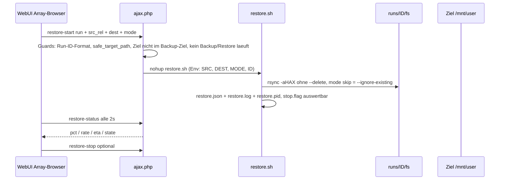

# ArrayBackup – Restore aus dem Array-Browser + Disk-Historie entfernen

## Kontext

- Die 3. Ansicht **Disk-Historie** (perdisk-Browser) ist mit dem gemeinsamen
  `fs/`-Layout nutzlos geworden: `perdisk/<disk>/<run>` verlinkt nur noch auf
  dieselbe `runs/<run>/fs`-Baum wie der Array-Browser. → Tab entfernen.
- Gewünscht: **Restore direkt aus dem Array-Browser** für einzelne Dateien und
  ganze Verzeichnisse. Asynchron (rsync-Hintergrund-Job, emhttp blockiert
  nicht). Ziel: **Original-Share unter `/mnt/user/<share>` ODER ein frei
  wählbarer Zielordner** (z. B. `/mnt/user/restore-test`), damit gefahrlos
  erst getestet werden kann.

## Architektur (Restore-Flow)

## Sicherheit / Guards

- Run-ID strikt `r-\d{8}-\d{6}`; Quell-Pfad relativ über `safe_target_path()`
  (Traversal-Schutz vorhanden). Unsichtbare Metadateien (`.runmeta.json`,
  `.pinned`, `.ab-staging`) als Restore-Quelle ablehnen.
- Ziel-Pfad: absolut, muss unter `/mnt/` liegen, **nie** gleich oder innerhalb
  des Backup-Ziels (`CFG_TARGET`), nicht `/` selbst. `/mnt/user` erlaubt, um
  ganze Shares wiederanzulegen. Kein `--delete` ever – Restore ist additiv.
- Overschreib-Modus wählbar: `overwrite` (Default) oder `skip`
  (`--ignore-existing`).
- Locks: nur ein Restore gleichzeitig (`/var/run/arraybackup/restore.pid` mit
  cmd-Check wie `engine_running()`), und kein Restore während eines Backup-Laufs
  (und umgekehrt prüft das nicht – nur Restore-Seite blockiert Backup-Start
  zusätzlich via `restore_running()` in `case 'start'`).
- Stop analog Backup: `restore.stop.flag` → rsync wird beendet, Status
  `aborted`.

## Dateien & Änderungen

| Datei | Änderung |
|---|---|
| `src/ArrayBackup.page` | Tab „Disk-Historie" + Panel `ab-panel-history` + JS (`view2`, `browse2`, `loadDiskOptions`, `loadSnaps`, Tab-Handler `history`) + i18n-Keys (`tab_history`, `perdisk_title`, `lbl_disk`, `lbl_snap`, `no_disk_history`) entfernen. Browser-Zeilen bekommen Restore-Button (Datei + Verzeichnis). Restore-Dialog (Run/Quelle readonly, Ziel-Auswahl: Share-Dropdown `/mnt/user` oder Freitext-Pfad, Modus radio), Fortschritts-Karte mit Balken (sessionStorage wie Backup-Fortschritt), Stop-Button. Neue i18n-Keys de/en. |
| `src/include/ajax.php` | Neue Actions: `restore-start` (Guards + nohup restore.sh), `restore-status` (GET, liest `restore.json` + running-Check), `restore-stop` (stop.flag), `shares-list` (GET: Top-Level-Dirs des gewählten Laufs unter `fs/` für die Ziel-Dropdowns). `case 'start'`: Start ablehnen während Restore läuft. |
| `src/include/restore.sh` | **Neu**: asynchroner rsync-Job. Env `AB_SRC`, `AB_DEST`, `AB_MODE`, `AB_RID`. `rsync -aHAX --numeric-ids --stats --info=progress2`, loggt nach `/boot/config/plugins/arraybackup/logs/restore.log`, schreibt `/var/run/arraybackup/restore.json` (pct/rate/eta/state/elapsed) via php mit bash-Fallback (Muster aus engine.sh `write_json`), respektiert `restore.stop.flag`, aufräumen des pid-Files, Exit-0/24 = success. |
| `build.sh` | `src/include/restore.sh` in die FILE-Schleife aufnehmen (mode 0755, kein Run), Version `2026.11.06.005`, CHANGES-Eintrag. |
| `src/include/engine.sh` | Symlink-Erstellung für **`perdisk/` UND `pershare/`** bei Promotion entfernen (Zeilen 944-955). Zusätzlich einmaliger Legacy-Cleanup beim Engine-Start: `rm -rf "$CFG_TARGET/perdisk" "$CFG_TARGET/pershare"` (enthält nur Symlinks, `runs/` bleibt heil). Die bestehenden Prune-Schleifen (Zeilen 636, 657) bleiben als harmlose Altlasten-Bereinigung ein Release lang drin. `shares-list` in ajax.php liest die Shares direkt aus `runs/<id>/fs`, braucht `pershare/` also nicht. |
| `src/include/ajax.php` (delete-run) | Die beiden `glob(.../perdisk/*/$id)`- und `pershare/*/$id`-Links in `delete-run` (Zeilen 231-232) bleiben als Altlasten-Räumung für Runs älterer Versionen. |
| `README.md` | Feature-Liste (Zeilen 18-19), Ziel-Baum-Diagramm (142-146), Promotions-Beschreibung (153-158, 188-190) und Retention-Testzeile (212) auf `latest` + `runs/` reduzieren; Restore-Feature beschreiben. |

## Restore-UI-Ablauf (Kurzfassung)

1. Array-Browser: Eintrag (Datei **oder** Verzeichnis) → Button „Wiederherstellen".
2. Dialog zeigt: Quelle `runs/<id>/fs/<pfad>`; Ziel-Dropdown: Shares aus dem Lauf
   (gemappt auf `/mnt/user/<share>`) **oder** „Benutzerdefiniert" + Freitextfeld
   (z. B. `/mnt/user/restore-test/games`); Modus overschreiben/skippen.
3. Start → Karte „Laufender Restore" mit Fortschritt; Stop möglich; Abschluss
   als Banner (Erfolg/Fehler mit rsync-Exit).

## Weitere Verbesserungsideen (nicht Teil dieses Plans)

- Einzelner **Download**-Link pro Datei im Browser (Streaming über ajax.php).
- Restore eines **gesamten Laufs** (alle Shares) als Spezialfall des Dialogs.
- **Unraid-Benachrichtigung** (dynamix notification API) bei Lauf-Ende/Fehler.
- Integritäts-Prüflauf (`rsync -c`) als eigener „Verify"-Knopf.
- i18n: Umschalter DE/EN in der WebUI (Strings existieren bereits).
